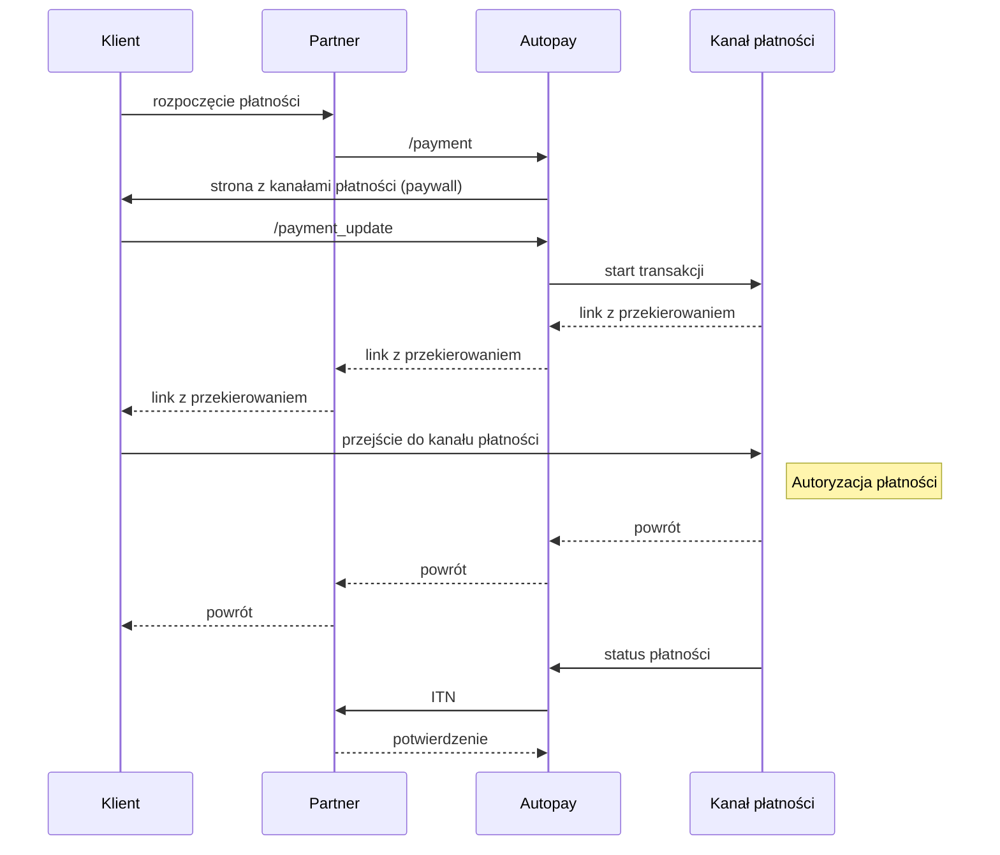
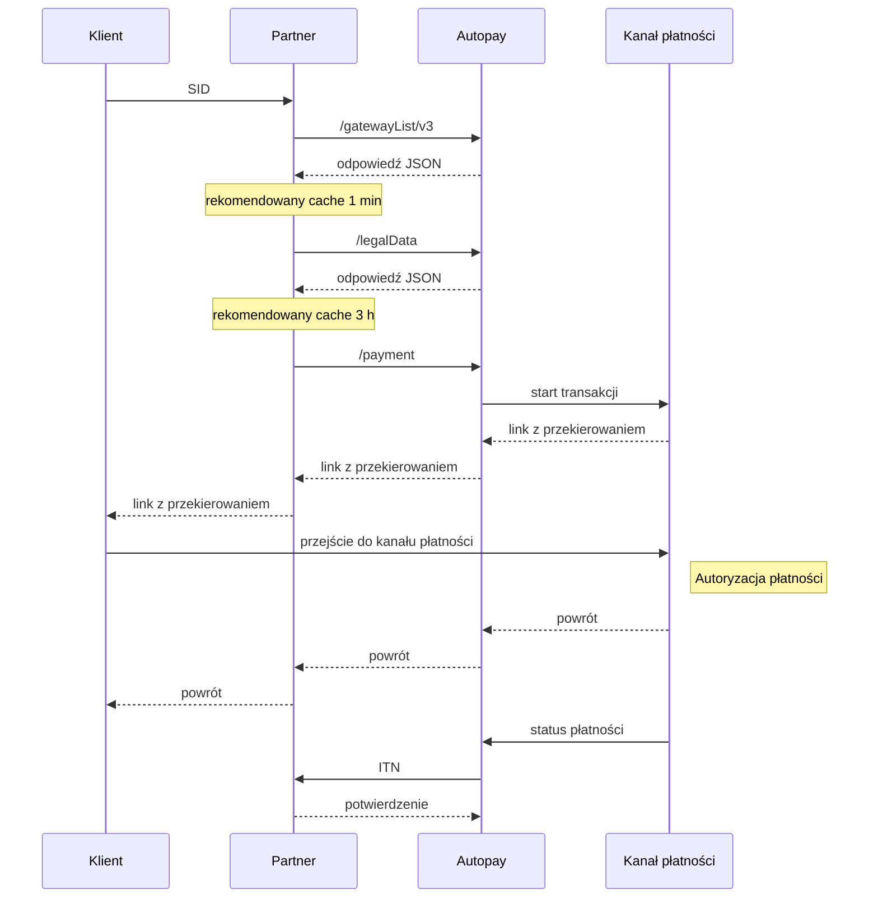

# Jak działa płatność

## Schemat działania usługi obsługi transakcji i rozliczeń

W Serwisie Partnera, po skompletowaniu zamówienia, Klientowi prezentowana jest opcja możliwości wykonania płatności z wykorzystaniem Systemu. Kliknięcie w odpowiedni link powoduje rozpoczęcie transakcji i otwarcie w nowym oknie:

a) dedykowanej strony Systemu przygotowanej przez AP, na której Klientowi prezentowana jest lista dostępnych Kanałów Płatności oraz podsumowanie zarejestrowanej transakcji (patrz [Model Paywall](payment-overview.md#model-paywall)) lub

b) bezpośrednio strony Kanału Płatności (Banku, BLIK lub do płatności Kartą) - (patrz [Model WhiteLabel](../whitelabel/payment-method-selection.md#model-whitelabel)).

Po stronie Systemu następuje walidacja przekazanych parametrów i zapisanie transakcji z ustalonym okresem ważności. Jeśli w momencie walidacji, czas ważności linku będzie już przekroczony, Klientowi zostanie wyświetlony odpowiedni komunikat (weryfikacja ważności transakcji następuje także przy zmianie statusu płatności). Po pozytywnej weryfikacji parametrów transakcji (oraz po wybraniu Kanału Płatności), Klient dokonuje autoryzacji transakcji. W jej tytule, oprócz nadawanych przez System identyfikatorów, może być także umieszczany stały opis, ustalony wcześniej pomiędzy AP a Partnerem lub dynamiczna wartość przekazywana przez Partnera przy starcie transakcji.

**Zalecany model integracji** polega na nadaniu komunikatu rozpoczęcia transakcji w tle, tzn. bez przekierowania użytkownika do Systemu (patrz [Przedtransakcja](../zaawansowane-scenariusze-platnosci/pretransaction.md#przedtransakcja)). W tym modelu, możliwe jest zastosowanie zaawansowanych form autoryzacji transakcji (WhiteLabel, płatności automatyczne, SDK mobilne), diagnozowania poprawności przekazywanych parametrów oraz wielu innych rozszerzeń.

Po zakończeniu autoryzacji transakcji (na stronie Kanału Płatności) klient powraca z niego do Systemu, gdzie następuje automatyczne przekierowanie Klienta do Serwisu Partnera.


Szczegółowy opis struktury linku powrotu znajduje się w części [Przekierowanie do serwisu Partnera](../podstawowy-proces-platnosci/customer-redirect.md#przekierowanie-do-serwisu-partnera).


Otrzymany z Kanału Płatności status autoryzacji (płatności) przekazywany jest z Systemu do Serwisu Partnera za pomocą komunikatu ITN. System będzie ponawiać wysyłanie komunikatów, aż do potwierdzenia odbioru przez Serwis Partnera lub upłynięcia czasu ważności powiadomienia. Transakcje, które zostaną zapłacone po opływie okresu ważności transakcji – zostaną zwrócone do Klienta (nadawcy przelewu).

Opcjonalnie System może powiadamiać o fakcie wystawienia Transakcji rozliczeniowej. Służy do tego odpowiednio zmodyfikowany komunikat ISTN.

## Schematy obsługi transakcji i rozliczeń

> W tej części przedstawione są modele, scenariusze zdarzeń i przepływu informacji.

### Obsługa transakcji

Poniżej znajdziemy diagramy sekwencji dla 2 modeli integracji.

#### Model Paywall

Model najprostszy, gdzie wybór kanałów płatności znajduje się na stronach Autopay (paywall).

#### Model WhiteLabel

Wybór kanału płatności odbywa się w Serwisie Partnera, który pobiera listę kanałów i wymagane regulaminy z Autopay. Szczegóły w części [Model WhiteLabel](../whitelabel/payment-method-selection.md#model-whitelabel).

