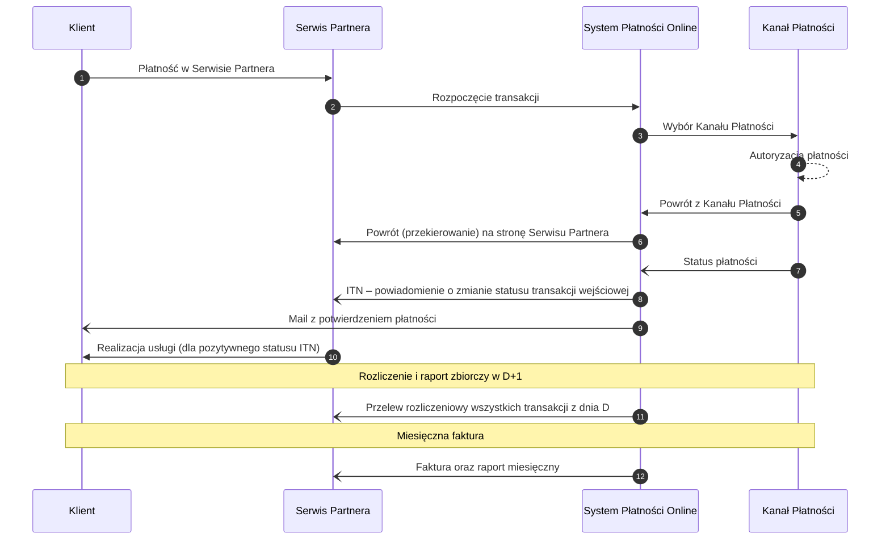
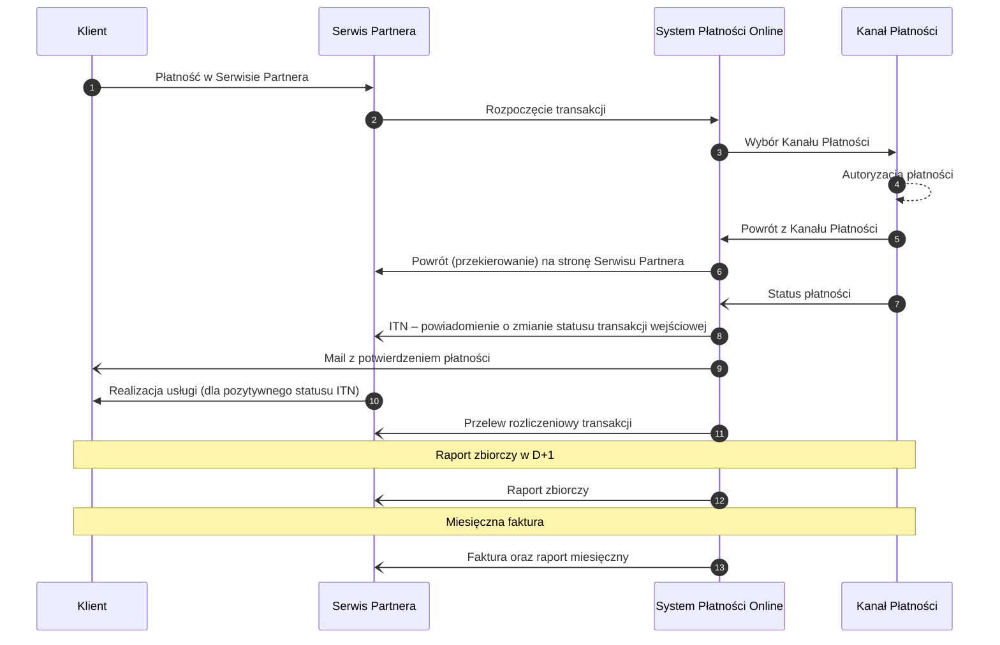
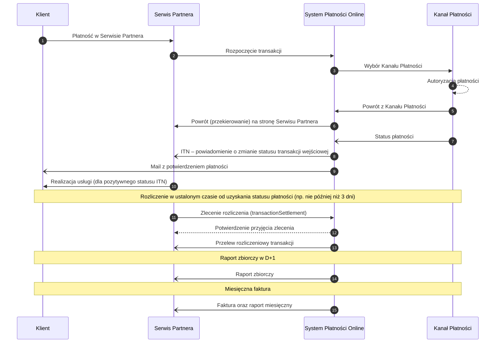

# Modele rozliczeń

Model rozliczeń określa, kiedy i w jaki sposób Autopay przekazuje Partnerowi środki z opłaconych transakcji.

## Model rozliczeń zbiorczych transakcji (model domyślny)

Rozliczenia zbiorcze następują następnego dnia roboczego (D+1).

## Model rozliczeń transakcji po każdej wpłacie

Rozliczenia po każdej wpłacie wykonywane mogą być niezwłocznie po otrzymaniu wpłaty od Klienta na wskazane w parametrach Linka płatności dane transakcji (opcje: Konto odbiorcy, Tytuł przelewu rozliczeniowego, Nazwa odbiorcy przelewu rozliczeniowego).

## Model rozliczeń transakcji na żądanie

Rozliczenia mogą być zlecane przez Partnera poprzez wywołanie metody: **transactionSettlement**.

<!-- TODO MIG-026: Brak kontraktu metody transactionSettlement (parametry, odpowiedź, Hash). Do ustalenia na spotkaniu z analitykami. -->


Szczegóły wywołania metody **transactionSettlement** ustala się z opiekunem biznesowym w trakcie integracji.


