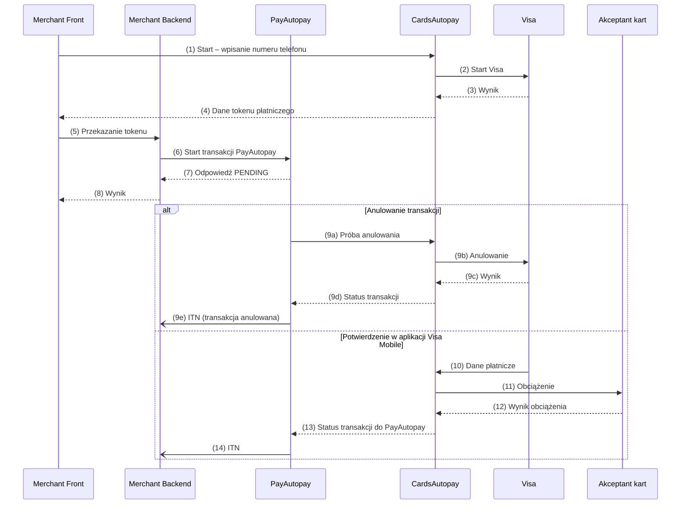

# Widget Visa Mobile

## Widget Visa Mobile - Przykład implementacji na stronie partnera

Poniżej przykład prostej implementacji HTML/JS z użyciem widget'u VisaMobile (oraz Widget'u kartowego)

```javascript
{ 'status': 'FORM_SUCCESS', 'message': 'eyJrZ...', ... }
```

Kluczowe dla tej integracji jest miejsce w kodzie JS, które odpowiada za odebranie event'ów, a szczególnie event'u o statusie `FORM_SUCCESS`, zawiera on bowiem w polu `message` wartość paymentToken'u, którą merchant musi przekazać do swojego backend'u w celu skompletowania parametrów do Autopay API umożliwiających start płatnośći w Autopay.

**Przykładowa strona**

W przeglądarce poniższa, przykładowa strona składa się z trzech sekcji:

* sekcja górna zawiera ikony/przyciski konkretnych kanałów płatności (z wykorzystaniem reprezentacji graficznych z Autopay)
* sekcja środkowa zawiera miejsce, w którym znajduje się HTML IFRAME, do którego, w razie potrzeby, umieszczany będzie adres widget'u (visamobile lub standardowego kartowego wedle potrzeby)
* sekcja dolna zawiera (domyślnie nieaktywny) przycisk `PayButon` spięty z SDK JS sterujący uruchomieniem procesu w widget'cie (w tym przykładzie przycisk uaktywnia się dopiero, gdy otrzymuje komunikat o poprawnej walidacji i uzyskaniu kompletu danych potrzebnych do wystartowania procesu)

> TODO MIG-060: Brak obrazu/diagramu: images/widget-empty-example-page-start.png. Dostarczyć oryginalny plik; nie zastępować wygenerowanym diagramem.

Kiedy zostanie wybrany kanał przeznaczony dla VisaMobile, wyświetla się dedykowany widok (oparty o HTML IFRAME), w którym podanie pełnego numeru telefonu (dzięki komunikatom walidacji) skutkuje uaktywnieniem przycisku "Zapłać".

> TODO MIG-061: Brak obrazu/diagramu: images/widget-visa-mobile-example-page-loaded.png. Dostarczyć oryginalny plik; nie zastępować wygenerowanym diagramem.

**Walidacja i skompletowanie danych**

W momencie wpisywania numeru telefonu Autopay Widget JS SDK otrzymuje od widget'u event'y `VALIDITY_STATUS` z wartoscią `valid: false` Gdy uzyskamy pełen numer telefonu, ostatnim event'em będzie `VALIDITY_STATUS` z wartością `valid: true`

```javascript
{status: 'VALIDITY_STATUS', message: null, valid: true, id: 'M2Zl...mU2'}
```

O ten event można oprzeć uaktywnianie przycisku `PayButton`

> TODO MIG-062: Brak obrazu/diagramu: images/widget-visa-mobile-example-page-ready.png. Dostarczyć oryginalny plik; nie zastępować wygenerowanym diagramem.

**Uzyskanie tokenu**

Przycisk należy powiązać z Autopay Widget JS SDK tak, aby jego kliknięcie triggerowało wywołanie metody `widget.sendForm();` w obiekcie `WidgetConnection` Co finalnie, zaowocuje uzyskaniem event'u `FORM_SUCCESS`, czyli uzyskaniem wartosci paymentToken'u.

```javascript
{status: 'FORM_SUCCESS', message: 'eyJ...n19', prefix: '48', phoneNumber: '666666666', id: 'M2Z...ZmU2'}
```

> TODO MIG-063: Brak obrazu/diagramu: images/widget-visa-mobile-example-page-clicked.png. Dostarczyć oryginalny plik; nie zastępować wygenerowanym diagramem.

## Widget Visa Mobile - Szczegółowy schemat komunikacji i wymiany danych



Start transakcji:

* (1) Start poprzez wpisanie numeru telefonu w widget'cie VisaMobile
* (2) Wystartowanie transakcji w systemie VisaMobile
* (3) Zwrotka z VisaMobile
* (4) Zwrócenie z widget'u do Merchanta (za pomocą JS) wygenerowanego `paymentToken'a`
* (5) Front Merchanta przekazuje do Backendu Merchanta token płatniczy
* (6) Następuje backendowy start [Przedtransakcji z paymentToken'em](../../zaawansowane-scenariusze-platnosci/pretransaction.md#przedtransakcja) otrzymanym wcześniej paymentToken'em
* (7) Zwrotka dostaje od razu odpowiedź XML PENDING (ponieważ jest procesowana w tle)
* (8) Na froncie Merchanta zaprezentowane zostaje ekran oczekiwania na wynik

Ewentualne anulowanie transakcji (z poziomu paywall'a PayAutopay ):

* (9a) Jeśli użytkownik nie dostanie powiadomienia w aplikacji mobilnej lub zmieni zdanie ma możliwość anulowania transakcji z poziomu paywall'a
* (9b) Z systemu CardsAutopay wysyłany jest request anulujący do Visa
* (9c) System CardsAutopay otrzymuje wynik anulowania z Visa
* (9d) Wynik anulowanie zostaje przyjęty przez system PayAutopay oraz zeprezentowany użytkownikowi na paywall'u PayAutopay
* (9e) Równolegle jest wysyłany [ITN](../../powiadomienia/itn.md#powiadomienia-natychmiastowe-itn) (ze statusem negatywnym) do Merchanta

Obciążenie i zwrócenie wyniku:

* (10) Oczekiwanie na dane tokenu płatniczego z Visa (jeśli klient VisaMobile potwierdzi w aplikacji mobilnej chęć zapłacenia konkretną kartą za dane zamówienie)
* (11) Następuje zlecenie obciążenia
* (12) Otrzymujemy pozytywny lub negatywny wynik obciążenia
* (13) Następuje przesłanie stanu transakcji do bramki PayAutopay
* (14) Bramka Autopay wysyła wynik transakcji do Merchanta w formie [ITN'a](../../powiadomienia/itn.md#powiadomienia-natychmiastowe-itn)

[Kompletny przykład HTML/JS dla obu wariantów](cards.md#omówienie-przykładowego-kodu-html-js-widget-kartowy-i-visamobile).
