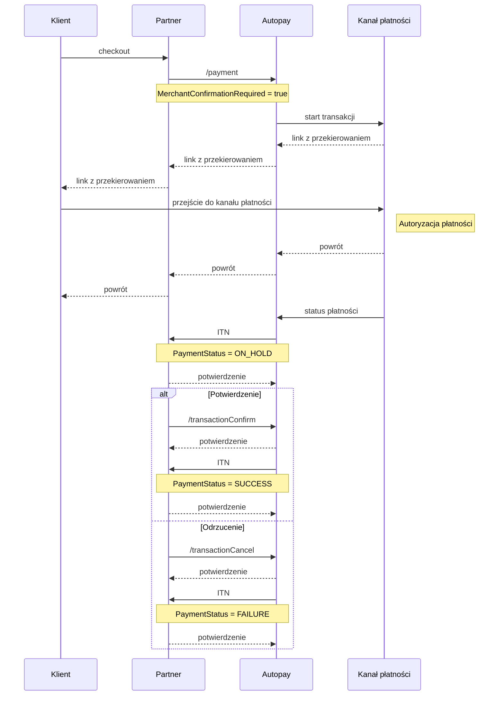

# Płatność z potwierdzeniem merchanta

## Płatność z potwierdzeniem merchanta


Jeżeli interesuje Cię usługa - zgłoś się do swojego opiekuna biznesowego.


### Opis ogólny działania usługi płatności z potwierdzeniem merchanta

Proces płatności z potwierdzeniem merchanta to model płatniczy, w którym środki klienta są wstępnie przyjmowane, a następnie – dopiero po decyzji merchanta – przekazywane Merchantowi do rozliczenia ([/transactionConfirm](#opis-metody-potwierdzającej-transakcję)) lub zwracana na rachunek Klienta ([/transactionCancel](../pozostale-operacje-api/cancel-transaction.md#anulowanie-nieopłaconej-transakcji)) na żądanie Merchanta albo na skutek upływu czasu. Umożliwia to weryfikację zamówienia, sprawdzenie dostępności towaru lub wykonanie dodatkowych procesów decyzyjnych, zanim środki faktycznie zostaną przekazane na rachunek bankowy Merchanta. Poniżej przedstawiono przebieg procesu zgodnie z diagramem sekwencji.



### Inicjalizacja procesu

Klient inicjuje płatność na stronie lub w aplikacji Merchanta, wybierając metodę płatności wspierającą model płatności z potwierdzeniem Merchanta (BLIK, PBL, PIS, płatności kartowe). Merchant wysyła do systemu płatniczego żądanie rozpoczęcia transakcji z włączonym parametrem: **MerchantConfirmationRequired=true**

Parametr ten informuje PSP, że transakcja wymaga późniejszej decyzji merchanta.

### Rejestracja transakcji i wstępne przyjęcie środków

Po zautoryzowaniu transakcji przez Klienta i otrzymaniu informacji o pobraniu środków, Autopay potwierdza ten fakt poprzez wysłanie komunikatu ITN ze statusem **paymentStatus = ON\_HOLD** - oznaczający wstępne przyjęcie środków i oczekiwanie **na pozytywną lub negatywną decyzję** merchanta albo upływ czasu.

### Decyzja merchanta

W późniejszym momencie (asynchronicznie), po wykonaniu swoich procesów biznesowych, merchant podejmuje decyzję co do dalszego losu transakcji.

### Decyzja pozytywna – pobranie środków (/transactionConfirm)

Jeżeli transakcja jest poprawna i zamówienie może zostać zrealizowane Merchant powinien wywołać endpoint [/transactionConfirm](#opis-metody-potwierdzającej-transakcję) co oznacza chęć przekazania środków do ostatecznego rozliczenia. Na potwierdzenie transakcji ma maksymalnie 120 minut (liczone od momentu otrzymania przez Autopay potwierdzenia autoryzacji). Potwierdzeniem ostatecznej akceptacji transakcji jest asynchroniczny komunikat ITN ze statusem **paymentStatus = SUCCESS**.

### Decyzja negatywna – anulowanie transakcji ([/transactionCancel](../pozostale-operacje-api/cancel-transaction.md#anulowanie-nieopłaconej-transakcji)) lub timeout

Jeśli transakcja nie może zostać zrealizowana (np. brak towaru, błąd zamówienia, negatywna weryfikacja), Merchant powinien wywołać metodę [/transactionCancel](../pozostale-operacje-api/cancel-transaction.md#anulowanie-nieopłaconej-transakcji). Ostatecznie, jeśli merchant nie podejmie decyzji w odpowiednim czasie, może wystąpić **timeout**, co jest równoznaczne z automatycznym żądaniem anulowania transakcji przez Merchanta. Potwierdzenie anulowania transakcji jest wysyłka komunikatu ITN ze statusem **paymentStatus = FAILURE** - oznaczający zwrot środków do Klienta.

### Opis metody potwierdzającej transakcję

Metoda **https://{host\_bramki}/webapi/transactionConfirm** służy do **finalizacji transakcji** w modelu płatności z potwierdzeniem merchanta poprzez pobranie wcześniej zablokowanych środków (zakomunikowanych statusem ITN **paymentStatus = ON\_HOLD**). Wywołanie tej operacji jest wykonywane przez Merchanta, po zakończeniu weryfikacji zamówienia (np. potwierdzeniu dostępności, poprawności danych, decyzji antyfraudowej). Po poprawnym potwierdzeniu transakcji Autopay przekaże wynik w komunikacie ITN ze statusem **paymentStatus = SUCCESS**.

### Lista parametrów żądania metody potwierdzającej transakcję

Wszystkie parametry przekazywane są metodą POST (Content-Type: application/x-www-form-urlencoded). Protokół rozróżnia wielkość liter zarówno w nazwach jak i wartościach parametrów.

Dodatkowo podczas wywołania należy przesłać nagłówek HTTP BmHeader o wartości pay-bm (**BmHeader: pay-bm**).


Kolejność atrybutów do wyliczenia Hash musi być zgodna z ich numeracją.


| kolejność Hash | nazwa     | wymagany | typ            | opis                                                                                                                                                                                                                                                                                |
| -------------- | --------- | -------- | -------------- | ----------------------------------------------------------------------------------------------------------------------------------------------------------------------------------------------------------------------------------------------------------------------------------- |
| 1              | ServiceID | TAK      | integer        | Identyfikator Serwisu Partnera.                                                                                                                                                                                                                                                     |
| 2              | MessageID | TAK      | string{32}     | Identyfikator komunikatu o długości 32 znaków alfanumerycznych alfabetu łacińskiego (np. na bazie UID), wartość pola musi być unikalna i wskazywać konkretne zlecenie wypłaty w Serwisie Partnera.                                                                                  |
| 3              | RemoteID  | TAK      | string{1,20}   | Alfanumeryczny identyfikator transakcji nadany przez System oraz przekazywany do Partnera w komunikacie ITN transakcji wejściowej. Jego podanie spowoduje obciążenie karty zautoryzowanej w transakcji o wskazanym **RemoteID**, jeśli jest w stanie blokady (**status ON\_HOLD**). |
| nd.            | Hash      | TAK      | string{1, 128} | Wartość funkcji skrótu dla komunikatu obliczona zgodnie z opisem w części [Bezpieczeństwo transakcji](../bezpieczenstwo/hashing.md#przykładowe-obliczenia-wartości-funkcji-skrótu-w-odpytaniu-o-listę-kanałów-płatności)                                                            |

### Lista parametrów odpowiedzi metody potwierdzającej transakcję

| kolejność Hash | nazwa        | wymagany | typ            | opis                                                                                                                                                                                                                                                                                                                                   |
| -------------- | ------------ | -------- | -------------- | -------------------------------------------------------------------------------------------------------------------------------------------------------------------------------------------------------------------------------------------------------------------------------------------------------------------------------------- |
| 1              | serviceID    | TAK      | string{1,32}   | <p>Identyfikator Serwisu Partnera. Pochodzi z żądania metody.<br><strong>Wymagany dla confirmation=CONFIRMED.</strong></p>                                                                                                                                                                                                             |
| 2              | messageID    | TAK      | string{1,20}   | <p>Pseudolosowy identyfikator komunikatu o długości 32 znaków alfanumerycznych alfabetu łacińskiego (np. na bazie UID). Pochodzi z żądania metody.<br><strong>Wymagany dla confirmation=CONFIRMED.</strong></p>                                                                                                                        |
| 3              | confirmation | TAK      | string{1,100}  | <p>Status potwierdzenia przyjęcia zlecenia.<br>Może przyjmować dwie wartości:<br>- CONFIRMED – operacja powiodła się. <em><strong>UWAGA:</strong> Nie oznacza to wykonania obciążenia! System asynchronicznie dostarczy ITN z <strong>paymentStatus=SUCCESS</strong>.</em> - NOTCONFIRMED – operacja nie powiodła się.</p>             |
| 4              | reason       | NIE      | string{1,1000} | Wyjaśnienie szczegółów przetwarzania żądania.                                                                                                                                                                                                                                                                                          |
| nd.            | hash         | TAK      | string{1,128}  | <p>Wartość funkcji skrótu dla komunikatu obliczona zgodnie z opisem w części <a href="../bezpieczenstwo/hashing.md#bezpieczeństwo-transakcji">Bezpieczeństwo transakcji</a>. <strong>Obowiązkowa weryfikacja zgodności wyliczonego skrótu przez Serwis Partnera</strong>.<br><strong>Wymagany dla confirmation=CONFIRMED.</strong></p> |

Przykładowa odpowiedź (XML):

```xml
<?xml version="1.0" encoding="UTF-8" standalone="yes"?>
<transaction>
    <serviceID>100</serviceID>
    <messageID>6781ba8534a1e0df655384d8e8a62acb</messageID>
    <confirmation>CONFIRMED</confirmation>
    <hash>eb5d9f9f7dd69e01d3a416d7140bd727838d67d8d465b494d793f0b8c137hdgc</hash>
</transaction>
```

